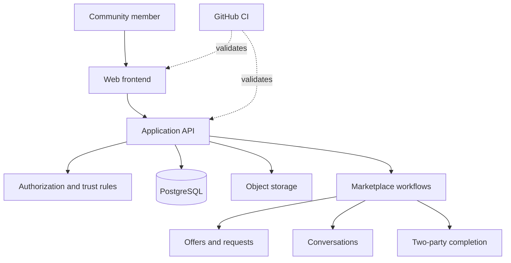

<div align="center">

# 🏡 Neighborly

### Your neighborhood has more to offer.

**A community-first marketplace for buying, selling, borrowing, and getting things done—closer to home.**

[](#project-status)
[](#quality-assurance)
[](#project-status)

**[Why Neighborly](#why-neighborly) · [Features](#features) · [Architecture](#architecture) · [Local development](#local-development) · [Roadmap](#roadmap)**

</div>

---

> [!IMPORTANT]
> **Neighborly is actively under development and has not been deployed to production.** The latest reported `main` commit is `f3e60fd`. CI passed 8/8 checks after the recent merges, but real-service end-to-end, security, accessibility, and backup/restore validation is still pending. Passing CI does **not** imply production readiness.

## The idea

The most useful things in a neighborhood are often already there: an unused power drill, a spare desk, a neighbor who can help move furniture, or someone who knows how to fix a bike.

**Neighborly brings those connections into one local marketplace.** Instead of treating every interaction as an anonymous transaction, it is designed around nearby people, practical needs, and trust.

<div align="center">

**Discover locally → Connect directly → Make it happen**

</div>

## Why Neighborly?

| The problem | The Neighborly approach |
| --- | --- |
| Useful items sit idle while nearby people need them | Make goods discoverable through local listings and borrowing flows |
| Finding help can mean navigating fragmented platforms | Bring requests, offers, and conversations into one product |
| Online marketplaces can make trust hard to judge | Surface verified status only when verification is real, and enforce seller restrictions |
| A transaction can get lost between messages | Model offers, requests, and completion as explicit workflow states |

## Features

Neighborly includes implementation work across the following areas. **The items below describe product capabilities or implemented controls—not a claim that every end-to-end scenario has passed real-service testing.**

### 🛍️ Local marketplace
- Create and explore community listings.
- Browse listings with dedicated URLs and a not-found experience for invalid routes.
- Keep paused listings out of active marketplace discovery.
- Prevent suspended sellers' listings from appearing in applicable discovery flows.

### 🤝 Offers and borrowing
- Create offers and borrowing requests through backend workflows.
- Retrieve relevant conversations and mission/request information.
- Track work toward transaction completion.
- Require confirmation from **both parties** before a job is considered complete.

### 💬 Conversations
- Support conversations associated with marketplace activity.
- Retrieve a conversation from the perspective of each participating user.
- Keep messaging within the context of marketplace workflows.

### 🛡️ Trust and safety
- Display the verified badge only for users who are actually verified.
- Apply authorization controls to sensitive workflows.
- Restrict dispute operations to authorized staff.
- Apply rate limiting to protected API routes.
- Return clearer errors for invalid resource identifiers.

### ⚙️ Developer and operations foundations
- Backend data modeling and migrations using Prisma.
- PostgreSQL-backed application data.
- Containerized local services with Docker Compose.
- Object-storage configuration used by the local test environment.
- CI checks integrated into the GitHub pull-request workflow.

## Product experience

```text
                   ┌────────────────────────┐
                   │   Discover Neighborly  │
                   │   Nearby opportunities │
                   └────────────┬───────────┘
                                │
                   ┌────────────▼───────────┐
                   │  Explore a listing     │
                   │  or community request  │
                   └────────────┬───────────┘
                                │
              ┌─────────────────┴─────────────────┐
              │                                   │
     ┌────────▼─────────┐               ┌─────────▼────────┐
     │  Send an offer   │               │  Request to      │
     │  or start a chat │               │  borrow an item  │
     └────────┬─────────┘               └─────────┬────────┘
              │                                   │
              └─────────────────┬─────────────────┘
                                │
                   ┌────────────▼───────────┐
                   │  Coordinate together  │
                   │  through conversation │
                   └────────────┬───────────┘
                                │
                   ┌────────────▼───────────┐
                   │  Both parties confirm │
                   │  completion           │
                   └────────────────────────┘
```

> These paths are a high-level model of the intended experience. The complete two-user journey is still awaiting real-service validation.

## Architecture

The project uses a web frontend, an API/backend layer, relational persistence, and local service infrastructure. The diagram below is deliberately conceptual; it is not an authoritative inventory of every package or service.



### Technology snapshot

| Layer | Technology / approach | Role |
| --- | --- | --- |
| Web UI | Frontend application | Marketplace and user interactions |
| API | Backend application | Offers, requests, conversations, state transitions |
| Database | PostgreSQL | Relational persistence |
| Data access | Prisma | Schema and migrations |
| Local infrastructure | Docker Compose | Development services |
| Object storage | S3-compatible local storage configuration | Storage workflows during local development |
| CI and collaboration | GitHub / GitHub Actions | Pull requests and automated checks |
| Validation | API, browser, accessibility, security and recovery testing | Release-readiness evidence |

For exact frontend and backend frameworks, inspect the checked-in package manifests before adding framework-specific badges or commands.

## Local development

### Prerequisites

- macOS, Linux, or another supported development environment
- **Node.js 22** and **pnpm**, as used in the previously reported local setup
- Docker Desktop / Docker Engine with Compose
- Access to the project repository and its documented environment variables
- Enough free disk space for container images, dependencies, volumes, and test data

### 1. Get the source

```bash
# Clone your actual Neighborly repository URL
# git clone <YOUR_NEIGHBORLY_REPOSITORY_URL>
cd neighborly
```

### 2. Configure the environment

Copy the repository's checked-in example environment file to the local environment filename required by the application, then fill in the development-only values.

**Never commit `.env` files or real credentials.** Check the current environment template for the definitive variable names.

### 3. Install dependencies

```bash
pnpm install
```

### 4. Start dependencies

```bash
docker compose up -d
```

### 5. Apply database migrations

```bash
pnpm exec prisma migrate status
# Apply migrations using the workflow documented in the repository.
```

### 6. Run the application

Check the workspace scripts before starting the services:

```bash
pnpm run
```

Use the scripts listed in the package manifests for the web and API processes. The application URL and ports depend on your local configuration; no public demo URL is currently advertised.

> [!CAUTION]
> The canonical Git workspace is `/Users/gadimani/Projects/neighborly-main` on APFS. The T7 checkout at `/Volumes/T7 Shield/Projects/neighborly` is retained for local staging data, evidence, and recovery; do not use its exFAT `.git` for development because AppleDouble metadata can corrupt Git indexes. Do not wipe or recreate existing Docker volumes just to set up a test run.

## Quality assurance

A successful build or a green CI badge is only one part of a release decision. Neighborly's remaining verification work is centered on **real running services**, not static code review.

### Reported CI state

- PR **#32 — DevOps**: merged as `860cf71`.
- PR **#33 — Frontend**: merged as `d15c5b2`.
- PR **#34 — Backend**: merged as `f3e60fd`.
- **8 of 8 CI checks passed** after each merge, per the latest project report.

### Outstanding release tests

| Validation area | What must be demonstrated | Current status |
| --- | --- | --- |
| Two-user E2E | Two accounts complete a realistic listing → interaction → completion journey | Pending |
| Security | Cross-user isolation, role permissions, suspension enforcement, rate limits | Pending |
| Accessibility | Keyboard interaction, focus management, semantic labels, automated/manual checks | Pending |
| API and data | Real-service state transitions, migration compatibility, error cases | Pending |
| Backup and restore | Restore a usable database from a verified backup in an isolated environment | Pending |

### Agent-assisted QA

A specialized QA team can divide testing across end-to-end, frontend/accessibility, backend, security and DevOps workstreams. **Every PASS should be backed by executed tests and reproducible evidence.** Agents must not merge fixes, deploy production changes, or run destructive operations against existing data without approval.

## Security model

Neighborly is being developed with safeguards for marketplace trust and transaction integrity:

1. **Verified identity representation:** verification indicators are only shown when the account actually satisfies verification requirements.
2. **Seller enforcement:** suspended sellers are restricted from appearing in relevant active listing discovery.
3. **Role-aware operations:** dispute management is restricted to staff roles.
4. **Transaction integrity:** completion requires confirmation from both participants.
5. **API hardening:** rate limits and invalid-ID handling reduce avoidable abuse and ambiguous failures.

These safeguards require adversarial testing before any production-readiness claim. Do not use production credentials or real user data in QA runs.

## Project status

**Current release verdict: `NOT READY`**

**Latest reported `main`:** `f3e60fd`  
**CI:** 8/8 reported passing after recent merges  
**Production deployment:** none  
**Real-service validation:** outstanding

### What the status means

- **Implemented / merged:** engineering changes have landed in `main`.
- **CI passing:** configured automated checks passed in the reported runs.
- **Not yet verified:** full workflows, security probes, accessibility and disaster recovery against real services.
- **Not deployed:** no production instance or public launch is being claimed.

## Roadmap

- [x] Merge recent DevOps, frontend and backend hardening work
- [x] Obtain passing CI on the updated main branch
- [ ] Run the complete synthetic and real-service two-user journeys
- [ ] Execute security and authorization probes
- [ ] Complete browser and accessibility testing
- [ ] Verify database backup and restore
- [ ] Fix confirmed release blockers and rerun affected tests
- [ ] Reassess staging readiness
- [ ] Approve and execute a controlled staging deployment
- [ ] Conduct production-readiness review before public launch

## Repository conventions

To contribute safely:

1. Create a feature or fix branch from the latest `main`.
2. Include tests for behavior changes.
3. Document migrations and environment changes.
4. Run the relevant automated checks.
5. Open a pull request with verification evidence.
6. Obtain review before merging or deploying.

When reporting an issue, include the expected behavior, actual behavior, reproduction steps, environment, and logs/screenshots with secrets removed.

## Philosophy

> **Better neighborhoods are built through better connections.**
>
> Neighborly is an effort to make everyday sharing, exchanging and helping feel local again—while treating engineering quality, safety, and trust as essential product features.

---

<div align="center">

### Built for the people next door.

**Neighborly** · Community first. Trust by design.

<sub>In active development · Not yet released to production</sub>

</div>
